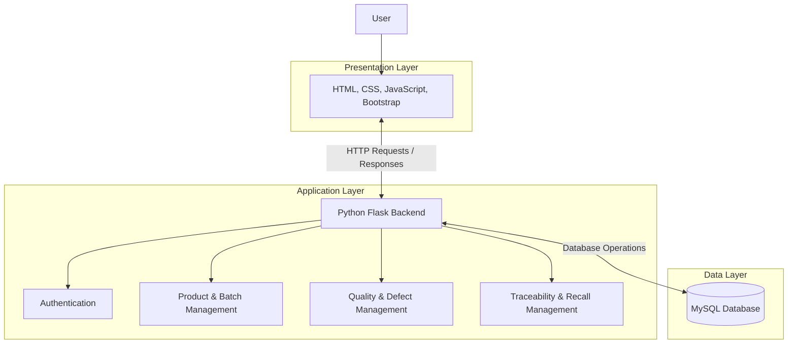

# ProductTrace – Product Recall & Supply Chain Traceability Platform

A full-stack web application built with **Python Flask and MySQL** to manage product information, track products across supply chain stages, record quality issues, and support product recall management.

**Live Application:** https://product-recall-supply-chain-traceability-9qpc.onrender.com/

---

## Overview

ProductTrace is designed to improve visibility and traceability throughout the product supply chain, from raw material procurement to the final customer.

The application maintains connected records of raw materials, production batches, products, quality inspections, warehouses, distributors, retailers, and customers.

It also supports defect reporting and recall management, helping identify potentially affected products through batch-level or individual product information.

## Key Features

- **Dashboard:** Provides an overview of production batches, products, defective products, and active recalls.
- **Raw Material Management:** Maintains raw material information.
- **Production Batch Management:** Organizes production details and batch records.
- **Product Management:** Maintains product details and individual product codes.
- **Quality Inspection:** Records product inspection results and quality issues.
- **Warehouse Management:** Maintains warehouse-related product information.
- **Distributor Management:** Manages distributor records.
- **Retailer Management:** Maintains retailer information.
- **Customer Management:** Maintains customer-related records.
- **Product Traceability:** Supports tracking using product codes and batch information.
- **Defect Reporting:** Records identified product defects.
- **Recall Management:** Supports batch-level and individual-product recall records.
- **Returned Products:** Maintains information about returned products.
- **Authentication:** Provides login functionality for application access.

## Supply Chain Workflow

The application represents the following product journey:

```text
Raw Materials
      |
      v
Production Batch
      |
      v
Products
      |
      v
Quality Inspection
      |
      v
Warehouse
      |
      v
Distributor
      |
      v
Retailer
      |
      v
Customer
```

ProductTrace maintains information across these stages to support product traceability.

## System Architecture

ProductTrace follows a three-tier web application architecture.



### Architecture Components

| Layer | Technologies | Responsibility |
|---|---|---|
| Presentation | HTML, CSS, JavaScript, Bootstrap | User interface and interaction |
| Application | Python, Flask | Routing, authentication and business logic |
| Data | MySQL | Application data storage and retrieval |

**Database Connectivity:** `mysql.connector`  
**Environment Configuration:** `python-dotenv`

## Technology Stack

| Category | Technologies |
|---|---|
| Programming Language | Python |
| Backend Framework | Flask |
| Frontend | HTML, CSS, JavaScript |
| UI Framework | Bootstrap |
| Database | MySQL |
| Database Connector | mysql.connector |
| Authentication Security | bcrypt |
| Environment Configuration | python-dotenv |
| Deployment | Render |
| Version Control | Git and GitHub |

## Project Structure

```text
Product-Recall-Traceability/
│
├── app.py
├── database.py
├── requirements.txt
├── .env
├── .gitignore
│
├── templates/
│   ├── base.html
│   ├── login.html
│   ├── dashboard.html
│   └── ...
│
├── static/
│   ├── css/
│   ├── js/
│   └── images/
│
└── README.md
```

*Note: This is an illustrative structure. Update it to match the actual files and folders in your repository.*

## Installation and Setup

Follow these steps to run ProductTrace locally.

### 1. Clone the Repository

```bash
git clone https://github.com/Rachitha18348/Product-Recall-Supply-Chain-Traceability-Platform.git
```

### 2. Navigate to the Project Directory

```bash
cd Product-Recall-Traceability
```

### 3. Create a Virtual Environment

```bash
python -m venv venv
```

### 4. Activate the Virtual Environment

**Windows PowerShell:**

```powershell
.\venv\Scripts\Activate
```

### 5. Install Dependencies

```bash
pip install -r requirements.txt
```

### 6. Configure the Database

- Start your MySQL server.
- Open MySQL Workbench.
- Create the database named `product_recall_db` if it does not already exist.
- Configure your database connection details.

### 7. Configure Environment Variables

Create a `.env` file in the project root directory.

```env
DB_HOST=localhost
DB_USER=root
DB_PASSWORD=your_mysql_password
DB_NAME=product_recall_db
```

Replace the example credentials with your actual local MySQL configuration.

### 8. Run the Application

```bash
python app.py
```

Open your browser and visit:

```text
http://127.0.0.1:5000/
```

## Live Deployment

ProductTrace is deployed using Render.

**Live URL:**  
https://product-recall-supply-chain-traceability-9qpc.onrender.com/

## Project Role and Contributions

**Role: Full Stack Developer**

- Developed the web application using Python Flask.
- Built frontend pages using HTML, CSS, JavaScript and Bootstrap.
- Implemented backend routes and application functionality.
- Integrated the Flask application with MySQL.
- Developed product, raw material and production batch management modules.
- Worked on quality inspection, defect reporting and recall functionality.
- Implemented product and batch-level traceability workflows.

## Future Enhancements

- QR code and barcode-based product identification.
- Automated recall notifications.
- Advanced supply chain analytics and reporting.
- Mobile application support.
- IoT-based product tracking.

## Author

**Rachitha Konduru**  
B.Tech – Computer Science and Engineering  
VIT-AP University

- GitHub: [Rachitha18348](https://github.com/Rachitha18348)
- Project Repository: [ProductTrace](https://github.com/Rachitha18348/Product-Recall-Supply-Chain-Traceability-Platform)

---

**ProductTrace – Improving Product Visibility, Traceability and Recall Management.**
